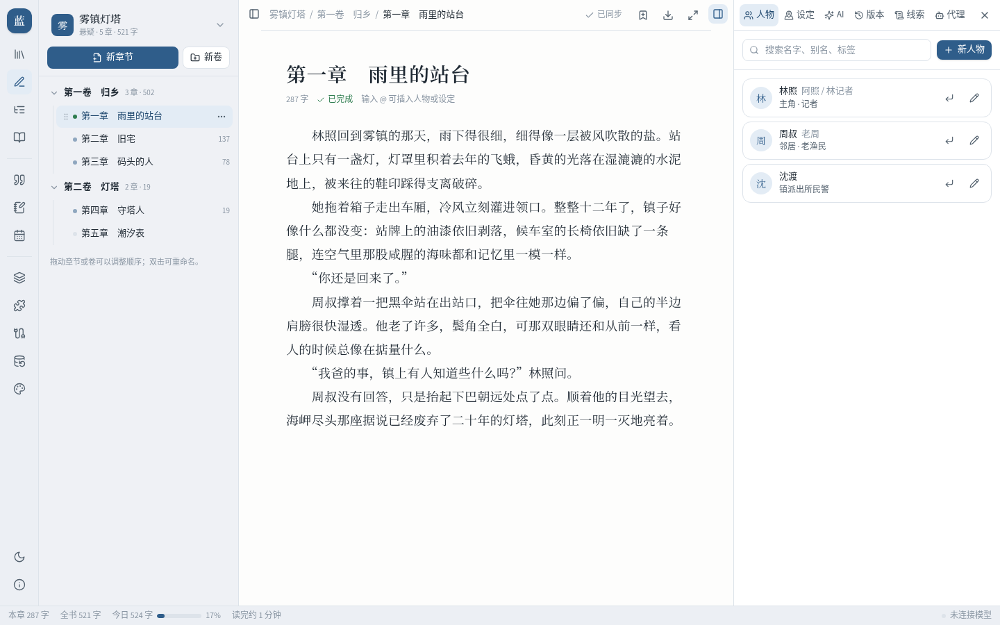

# 蓝稿

蓝稿是开源项目，采用 MIT 许可证。主导人是 Leo Lee。本软件由 Leo Lee 与 Grok Bot 合作制作。

Copyright (c) 2026 Leo Lee

蓝稿是单机中文写作软件。打开窗口就是书桌，不需要注册或登录。作品、设置和模型密钥都保存在你自己的电脑上。蓝稿本身不提供模型，你填写自己的密钥，调用费用由对应的模型服务商收取。

## 统一设置入口

点左下角带文字的齿轮「设置」，可以直接操作两组设置，不必再到各处找：

- **模型与 API**：选择白名单服务商和模型、填写或沿用加密密钥、保存、保存并测试。只点「保存」不会调用模型；「保存并测试」会请求服务商，可能产生费用。旧的模型连接引导和状态栏入口会直接进入这一分组。
- **外观与排版**：明暗、配色、字体、字号、行距、版心、段首缩进和打字机模式，带实时预览，自动保存在本机，刷新或重启后恢复。旧的外观入口仍打开这一组。

切换分组前请保存模型配置；未保存的模型输入不保留。界面主题快捷切换也已收进设置，避免入口散落。下方截图展示此前的书桌布局，设置入口以当前版本为准。

## 功能一览（第二版）



- **书桌布局**：左侧活动栏 + 目录，中间稿纸，右侧可收起的资料面板；窗口窄时右侧面板浮在正文上方。
- **外观**：浅色 / 深色 / 跟随系统；青花、宣纸、竹青、暮紫、胭脂五种配色；正文可选宋体（随软件附带）、黑体、楷体、仿宋，字号、行距、版心宽度可调，段首自动空两格，打字机模式。设置只保存在这台电脑上。
- **作品 → 卷 → 章节**：新建、重命名（双击）、删除（二次确认；删卷时可选保留章节）、拖动排序（章节可跨卷拖动，卷也能拖动），顺序保存在数据库里。
- **编辑器**：停笔约 1 秒自动保存，顶部显示「未保存 / 保存中 / 已保存」，`Ctrl+S` 立即保存；专注模式（`Esc` 退出）。
- **字数统计**：按中文习惯计数（汉字、假名、韩文每字算 1，英文单词、连续数字各算 1，标点不计）。状态栏显示本章、选中、全书、今日字数和每日目标进度。
- **版本历史**：写作时每 10 分钟或改动较大时自动留一版，也可以手动「存一版」；AI 替换、恢复版本之前都会自动留底。可逐字对比当前正文，一键恢复。
- **人物卡与设定库**：每部作品单独一套。人物卡有别名、身份、外貌、性格、档案、标签；设定分地点、物品、势力、概念、事件、其他。可搜索，写作时输入 `@` 或点「插入」即可把名字放进正文。
- **AI 写作工具**：续写、润色、扩写、缩写、改写（多种风格）、大纲、自由指令。选中文字会出现浮动工具条，结果逐字流出，可以替换原文、插入或复制，替换后 `Ctrl+Z` 能撤回。使用你在「设置 → 模型与 API」里选的服务商和密钥，只发往白名单里的官方地址；会参考作品的故事核、文风和与选段相关的人物设定。
- **导出**：本章 / 本卷 / 整部作品，导出为 Word（.docx）、EPUB、TXT、Markdown。文件在本机生成。
- **完整备份**：「数据与备份」里一键导出全部数据为一个 `.langao.json` 文件（作品、卷章、版本、人物、设定、诗歌手记、文风档案）。**不包含模型密钥**。恢复时可以「作为副本导入」，或「覆盖现有数据」（需要输入「覆盖」确认，覆盖前会把现有数据另存为数据目录下 `restore-points/` 里的恢复点文件）。
- 原有的大纲、诗歌、手记、日历、技能、插件、代理对话都还在：代理和「线索」（未收的线、评书）在右侧面板里。

## 别人可以怎么用

### 安装 Windows 版

安装包会放在 GitHub Releases：

<https://github.com/LeoLee0512/blue/releases>

目前还没有发布安装包。在维护者发布之前，请按下一节从源码构建。发布之后，下载 `langao-<版本>-setup.exe`（安装版）或 `langao-<版本>-portable.exe`（便携版），双击运行。安装版可以改安装目录；便携版解出后直接运行 `langao.exe`。窗口标题是「蓝稿」。不需要另外安装 Node.js，也不需要打开浏览器。

### 从源码构建

需要 Node.js 22.12 或更高版本，包括 Node.js 24。仓库里的 `engines` 已去掉「必须低于 23」的限制。

在中国大陆构建时，建议先让 Electron 走镜像，否则下载 Electron 二进制经常很慢或失败：

```bash
export ELECTRON_MIRROR=https://npmmirror.com/mirrors/electron/
export ELECTRON_BUILDER_BINARIES_MIRROR=https://npmmirror.com/mirrors/electron-builder-binaries/
```

Windows 上可以用：

```bat
set ELECTRON_MIRROR=https://npmmirror.com/mirrors/electron/
set ELECTRON_BUILDER_BINARIES_MIRROR=https://npmmirror.com/mirrors/electron-builder-binaries/
```

然后：

```bash
git clone https://github.com/LeoLee0512/blue.git
cd blue
npm ci
npm run dist:win
```

`npm run dist:win` 在 Windows 上生成安装包和便携版 exe，放在 `release/`：

- `langao-<版本>-setup.exe`：安装程序
- `langao-<版本>-portable.exe`：便携程序

在 Linux 上可以用 `npm run dist:win:zip` 打出可在 Windows 解压后运行的压缩包（里面是 `langao.exe`）。安装程序需要 Windows，或在 Linux 上安装能运行 32 位程序的 Wine。GitHub Actions 的 Windows 工作流会打出 exe，但不会自动发布 Release。

只想在本机打开开发中的窗口，而不打包：

```bash
npm run desktop
```

这会先做生产构建，再用 Electron 打开，不会启动 Vite 开发服务器。改界面时可以用 `npm run dev`，浏览器访问 `http://127.0.0.1:8080`。开发数据写在项目里的 `.data/`，和安装版的数据目录不是同一个。

### 第一次使用

1. 打开蓝稿，直接进入书桌。
2. 在书架上「开一部新书」，或者先打开左下角的「设置 → 模型与 API」。
3. 选择一家服务商，在下拉里选模型，填入你自己的 API 密钥，保存。火山方舟只列出固定的模型 ID，不能手写别的地址。
4. 密钥会加密后写到本机。蓝稿不提供默认模型，也不代收模型费用。

目前可选的服务商（只使用已备案服务商的官方接口）：

- DeepSeek（深度求索）
- 阿里云百炼（千问）
- 火山方舟（豆包）
- 智谱
- Kimi（月之暗面）
- MiniMax
- 讯飞星火（填写控制台里的 APIPassword）
- 阶跃星辰

「关于」页有备案名称、备案号和当前可选模型数量。聚合平台只开放平台自有品牌下的指定模型。

### 数据在哪里，怎么备份

安装版由 Electron 把数据放在系统的应用数据目录下，文件夹名是「蓝稿」：

| 系统 | 路径 |
| --- | --- |
| Windows | `%APPDATA%\蓝稿` |
| macOS | `~/Library/Application Support/蓝稿` |
| Linux | `~/.config/蓝稿` |

`npm run dev` 不写上面的目录，数据在项目里的 `.data/`。直接用 Node 启动生产服务、又没有设置 `LANGAO_DATA_DIR` 时，Linux 用 `$XDG_DATA_HOME/蓝稿`（默认 `~/.local/share/蓝稿`）。

里面主要有：

- `pglite/`：作品、大纲、正文、设置（嵌入式 Postgres）
- `install-secret`：这一次安装生成的加密密钥，用来解开模型 API 密钥
- `restore-points/`：用备份「覆盖」之前自动留下的恢复点文件（可以用「从文件恢复」导回）

最省事的备份方式是软件里的「数据与备份 → 导出完整数据」，得到一个 `.langao.json` 文件，换电脑后用「从文件恢复」导入；这个文件不含模型密钥，恢复后重新填写即可。也可以按下面的方法复制整个数据文件夹：

同一目录里还有窗口自己的缓存。备份时退出蓝稿，复制整个文件夹。恢复时放回原处。`pglite` 和 `install-secret` 必须一起在。只有数据库、没有 `install-secret` 时，作品还在，但已经保存的模型密钥解不开。不要把 `install-secret` 提交到仓库或发给别人。

`npm run dev` 的数据在项目目录 `.data/`，规则相同。

### MIT 许可证允许什么

许可证全文在仓库根目录的 `LICENSE`。简单说，在保留版权声明「Copyright (c) 2026 Leo Lee」和 MIT 许可声明的前提下，你可以：

- 使用这套软件
- 修改它
- 再分发原版或修改版，包括用于商业用途

软件按「原样」提供，没有担保。这是便于阅读的说明，不是律师意见；以 `LICENSE` 为准。

## 参与贡献

欢迎提 issue 和 pull request：

- <https://github.com/LeoLee0512/blue/issues>
- <https://github.com/LeoLee0512/blue/pulls>

请不要在 issue、提交或截图里放真实的模型密钥、`install-secret`、地址、电话或私人邮箱。

## 给维护者：怎么打一个发行包

工作流 `.github/workflows/windows-installer.yml` 会在手动触发，或推送 `v*` 标签时，在 Windows 上执行 `npm run dist:win`，并把 exe 上传为 Actions artifact。它不会创建 GitHub Release。

发布步骤：

1. 确认 `package.json` 里的 `version`。
2. 在装有 Node.js 22.12+（含 24）的 Windows 上执行上面的镜像变量和 `npm run dist:win`，或到 Actions 里手动运行 “Windows installer”。
3. 从 `release/` 或 Actions artifact 取出 setup 与 portable 两个 exe。
4. 在 GitHub 上新建一个 Release，把这两个文件附上去。不要把 `install-secret` 或任何人的数据目录打进安装包。

## 开发命令

```bash
npm test
npm run typecheck
npm run lint
npm run db:migrate   # 把 migrations/*.sql 应用到 LANGAO_DATA_DIR，默认是 .data
```

数据库迁移在应用启动时也会自动执行。

想要一份示例数据来试界面或截图：

```bash
export LANGAO_DATA_DIR=$PWD/.data/demo
npm run db:migrate
node --experimental-strip-types --import ./scripts/ts-alias-hooks.mjs scripts/demo-seed.ts
```

## English

Langao is an open-source, MIT-licensed desktop writing app. Leo Lee is the lead; it was made together with Grok Bot. Copyright (c) 2026 Leo Lee.

It is single-user and offline: no account, no sign-in. Works, settings, and model API keys stay on the local disk (`%APPDATA%\蓝稿` on Windows). Keys are encrypted with a per-install secret. Version 2 adds a three-pane writing desk (volume/chapter tree with drag-and-drop, autosaving editor with Chinese word counts and focus mode, version history with diff and restore, character cards and a worldbuilding library with @-mentions, streaming AI writing tools, light/dark themes with five palettes), export to DOCX/EPUB/TXT/Markdown, and a one-click full data export/restore that never includes API keys. Build a Windows installer with `npm run dist:win` (set `ELECTRON_MIRROR` and `ELECTRON_BUILDER_BINARIES_MIRROR` to the npmmirror URLs above when downloading Electron from mainland China). Node.js 22.12 or newer, including Node.js 24, is supported. GitHub Releases will host the `.exe` files later; this repository does not publish them by itself. The MIT license lets you use, modify, and redistribute the software if you keep the copyright and permission notices. Issues and pull requests are welcome.
